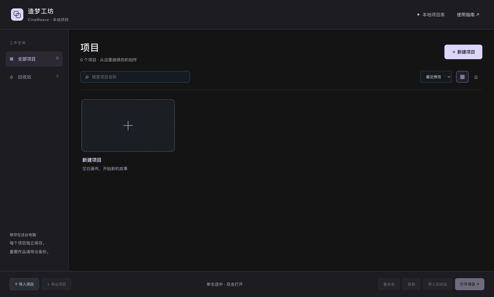

# CineWeave · 造梦工坊（经典版 v1.21.0）

一个本地优先的 AI 视频创作工作台：画布整理素材、资产管理、3D 导演台、关键帧与镜头编排、粗剪和成片导出，全部在同一个工程里完成。

> 这是「画布 + 剪辑」经典版源码（v1.21.0）。后续版本改成了六段流水线界面，不在本仓库。



## 功能

- **画布**：素材节点、连线、分组、对齐、框选、快捷键；剧本/分镜/资产与生成任务都可以落到画布
- **资产管理**：本地素材库、图片版本、提示词、官方资产与离线模型库
- **3D 导演台**：three.js 实时舞台、人物/机位/道具摆放、关键帧、动作片段、逐参数曲线、贝塞尔路径、机位监看
- **剪辑**：粗剪时间轴、素材库、版本对比、按镜头导出
- **项目管理**：多项目独立保存、缩略图、搜索排序、复制重命名、导入导出、回收站
- **本地优先**：只监听 `127.0.0.1`，工程与素材保存在本机，不依赖外网

## 技术栈

- Electron + 原生 JavaScript / CSS
- three.js（3D 导演台）
- Vite 构建
- Node.js 内置 http 服务 + 本机 CLI 桥接（图片/视频生成、Blender 预演）

## 快速开始

要求：Node.js 20+，macOS（打包脚本以 macOS 为主）。

```bash
npm install
npm run build
npm start          # 打开 http://127.0.0.1:4173
```

桌面版开发/打包：

```bash
npm run package:mac
npm run package:dmg
```

## 离线资产（不随仓库提供）

为了控制仓库体积，`public/assets/models/` 和 `public/assets/thumbnails/` 未上传。完整使用离线模型库需要：

1. 从 Release 页下载资产包（`assets-cc0.zip`）；
2. 解压到 `public/assets/`，保持 `models/` 与 `thumbnails/` 目录结构；
3. 重新 `npm run build`。

资产清单、来源与许可证见 [ASSETS.md](ASSETS.md)。即使没有资产包，画布、剪辑和大部分界面功能仍可运行。

## 许可证（双许可）

本项目采用 **AGPL-3.0** 开源许可证：

- **个人、学习、研究、非营利使用**：免费，可修改和分发
- **商业使用**：可以遵循 AGPL-3.0 使用（若分发或提供网络服务，需按 AGPL 公开对应源代码）；
  不适合开源自身代码的公司，可购买**商业授权**，获得闭源使用许可
- 商业授权联系：**wenshuai95@126.com**

完整条款见 [LICENSE](LICENSE)，商业授权说明见 [COMMERCIAL-LICENSE.md](COMMERCIAL-LICENSE.md)。

二次分发时请保留版权声明与许可证副本。

## 第三方许可

- three.js：MIT
- 离线模型与动画：CC0-1.0（Kenney、Quaternius），逐项来源与许可证文件在 `public/assets/licenses/` 与 [ASSETS.md](ASSETS.md)
- 其他依赖许可见 [THIRD-PARTY-LICENSES.txt](THIRD-PARTY-LICENSES.txt)

## 安全

- API Key 只保存在本机配置，不写入工程文件，也不应提交到仓库
- 服务仅监听本机回环地址
- 提交 Issue 前请勿粘贴密钥、工程内容或客户素材

## 贡献

欢迎 Issue 和 PR。提交代码即表示同意以本项目同一许可证授权维护者分发你的贡献；商业授权由维护者统一提供。

## 目录结构

```text
src/               前端源码（画布、导演台、剪辑、项目管理）
desktop/           Electron 主进程与打包脚本
public/assets/     manifest、许可证与（需单独下载的）模型
docs/              开发与设计文档
tests/             Node 测试
server.mjs         本地静态服务与 API 入口
```

## 版本

- v1.21.0：经典版（本仓库）
- 更新日志：见 `docs/` 下的版本说明
